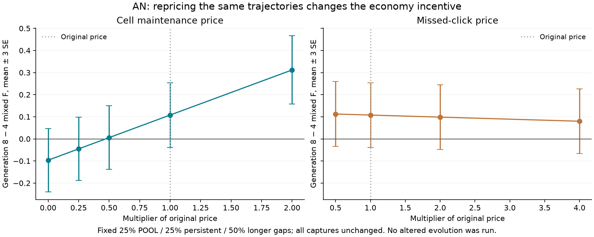

# AN maintenance and missed-click price sensitivity

On the same completed trajectories, lowering maintenance cost changes the average ranking of generation4 and8; moderate miss-price changes do not. This is a post hoc accounting result, not an experiment in what would evolve. Original prices and the active AO search remain unchanged.

Both panels share the vertical scale and show paired mean differences ±3SE. All captures are fixed. The original-price mixed-F advantage is+0.107797±0.048847 and does not clear3SE. See [the full note](NOTE.md), `summary.json`, and the reproducible `analyze.py`. The original AN evidence is in [its report](../occlusion_acquisition_20261015/REPORT.md).
