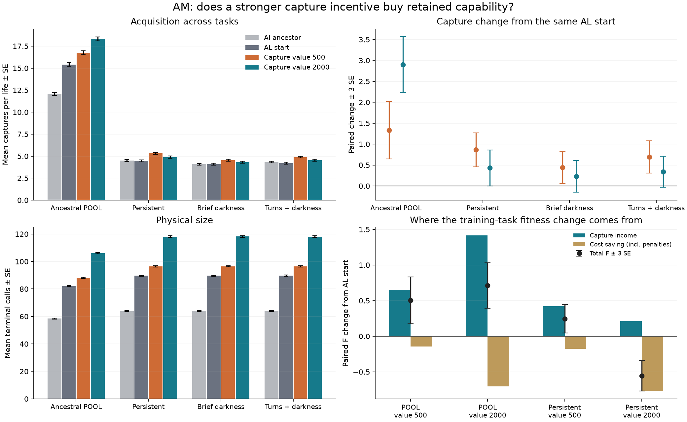

# AM: cumulative capture gains, without a joint advantage from higher reward

The original-price continuation improves captures in both training tasks and both known nearby test environments. Raising selection capture value fourfold buys a larger POOL gain, but produces larger, more expensive bodies and more missed clicks. It does not establish a capture advantage across both training tasks. This is useful cumulative capability progress in one lineage, not demonstrated memory, a new algorithm or an optimal price.

Both branches began with all 32 ordered AL-mixture survivors and used four generations of native 32+224 breeding, with eight initial and eight recheck lives. Selection was fixed 50/50 POOL/persistent. Only generation capture income differed: 500 versus 2,000. Every physical penalty and organism rule stayed unchanged. All native diagnostics and the 512-life-per-row confirmation used original capture value 500. Both endpoints were fixed before confirmation. All four environments are development cases.

## Captures and retained ability

| Environment | Earlier AI ancestor | AL start | Selected at 500 | Selected at 2,000 |
|---|---:|---:|---:|---:|
| POOL | 12.0586 | 15.4180 | **16.7500** | **18.3184** |
| Persistent | 4.5000 | 4.4590 | **5.3242** | **4.8906** |
| Brief irregular darkness, 80 on / 5 off | 4.0762 | 4.0918 | **4.5352** | 4.3184 |
| Faster turns plus the same darkness | 4.3281 | 4.1953 | **4.8906** | 4.5371 |

Values are mean captures per life. The original-price descendant's changes from its AL start are:

| Environment | Capture change, mean ± paired SE | Original-price F change | Extra ordinary cost in F |
|---|---:|---:|---:|
| POOL | **+1.332031 ± 0.229478** | **+0.504278 ± 0.109905** | 0.146128 |
| Persistent | **+0.865234 ± 0.135134** | **+0.245150 ± 0.066728** | 0.177328 |
| Brief darkness | **+0.443359 ± 0.128503** | +0.037129 ± 0.064285 | 0.179355 |
| Turns plus darkness | **+0.695312 ± 0.127998** | +0.168694 ± 0.064714 | 0.170814 |

All four capture changes clear the fixed lower-three-SE criterion. Extra capture income outweighs additional costs in both training tasks. Mean terminal cells increase modestly: 82.14 → 88.05 in POOL and 89.60 → 96.46 in persistent. Neither test-environment F gain clears three SE. Dark-capture changes are unresolved and slightly negative in the point estimates; improved total captures do not establish better use of absent cues.

The current-price descendant's capture gain is **0.421875 ± 0.132148 smaller in brief darkness than in persistent**, a resolved negative interaction. Its improvement transfers, but does not establish better occlusion robustness. Also, its persistent F remains **0.421625 ± 0.065424 below the earlier AI ancestor**. Capture retention and growth do not imply retention of every earlier cost-performance trade-off.

Both descendants pass the conventional 90% capture-retention diagnostics against AL in both training tasks and against AI in persistent. Both also clear simultaneous capture improvement over AL, although the high-reward branch's persistent gain, **+0.431641 ± 0.143367**, only narrowly clears the criterion: lower bound **+0.001540**. The earlier AL-versus-AI persistent retention uncertainty is resolved on these fresh lives under that same 90% convention: margin **+0.408984 ± 0.118987**, lower bound **+0.052024**. This tolerance permits some loss; it does not establish lossless retention. Full restoration to original L92 was not tested.

## What higher reward changed

The two co-primary high-minus-current capture effects are **+1.568359 ± 0.241853 in POOL** and **−0.433594 ± 0.151231 in persistent**. The joint advantage criterion fails. The persistent loss narrowly remains unresolved at three SE, rather than establishing equal performance or a resolved disadvantage.

At common original prices, high-minus-current F is **+0.208121 ± 0.115071 in POOL** and **−0.799722 ± 0.075178 in persistent**. The extra ordinary costs are 0.557680 and 0.588006 F respectively. Relative to AL, high-reward persistent F falls **0.554572 ± 0.071753** despite its narrow capture gain.

| World / quantity | AL start | Selected at 500 | Selected at 2,000 |
|---|---:|---:|---:|
| POOL terminal cells | 82.14 | 88.05 | 106.10 |
| POOL clicks per life | 35.79 | 38.69 | 55.90 |
| POOL misses per life | 20.37 | 21.94 | 37.58 |
| POOL fraction of clicks capturing a target | 43.08% | 43.29% | 32.77% |
| Persistent terminal cells | 89.60 | 96.46 | 118.14 |
| Persistent clicks per life | 30.42 | 33.69 | 44.28 |
| Persistent misses per life | 25.96 | 28.36 | 39.38 |
| Persistent fraction of clicks capturing a target | 14.66% | 15.80% | 11.05% |

Accuracy is descriptive total captures / total clicks, with no assumption that clicks are independent trials. Counts remain visible because a fraction alone can improve by attempting less. Higher-reward bodies also have more hidden cells: persistent mean 7.97 versus 1.09 in the current-price descendant and 2.44 in AL. More cells or activity is not proof of more useful circuitry. Whole-genome developmental differences prevent assigning causality to body size, click frequency or hidden cells.

## Interpretation and next decision

The incentive balance matters, but this single comparison gives no reason to declare 2,000 generally better or to infer an optimum. The current-price branch provides a promising balanced population for continuing capability acquisition. Both branches used more scoring lives than AL, so this experiment does not isolate evaluation precision from further evolution. One paired search does not establish evolutionary reliability.

The user's instruction is to finish an experiment, review the result, then choose the highest-value next experiment for richer, reusable evolved behavior. Follow-up options include a stronger information demand with earlier tasks retained, longer search, a targeted circuit probe or a search-policy change. Previous design sketches are options, not an automatic queue. The result supports reconsidering those options rather than starting a price sweep.

The figure's price labels refer to selection; every plotted evaluation uses 500. Absolute bars show SE and paired changes show three SE. SVG and plotted statistics are beside the PNG.

## Verification and resources

All **28,748 research + 8 startup = 28,756 calls** completed on the first attempt in **5,112.441715 CPU / 2,065.705032 wall seconds**. Search used 3,748.510189 CPU seconds and confirmation 1,363.931526, within 7,200 / 3,600 allocations and the 10,800 total cap. Peak sampled owned RSS was **326,066,176 bytes**. Four process identities and three groups are clear in their original namespace. No retry, scope extension or rented compute occurred.

All 8,192 confirmation statuses are zero. Initial guarded search-call counts were [8, 0, 3, 0] at current value and [8, 0, 8, 0] at high value; original penalties were retained. Full per-life search ledgers were not saved. All 896 offspring and 1,792 point additions per branch, final populations and gene origins reconstruct exactly. Both first 256 candidate cohorts match. Logged pooled selection verifies, with the documented limits from omitted discarded-parent scores and tie permutations. The offline native audit used another 4.043801 CPU seconds and no simulations.

The frozen reader passes unchanged. An independent literal-index accountant agrees exactly on all **4,064 paired vectors**, and a separate reader run reproduces summary and vector archive bytes. The accuracy supplement checks all 16 raw rows separately. The prospective publisher caught one changing offline helper-adaptation script before release; its original snapshot and final tested source are preserved in `evidence/publication_reconciliation.json`. Scientific sources and inputs were unchanged, and no simulation had begun.

Prospective commits: `bf431b6`, `16e46cd`.

- Protocol: `9210e218d92d912f8b63822980de7fab868ad8904417d0f438a55e2b42922294`
- Summary: `00bdc977555e07a2b5146c70e069749b2ff1044d9658d4727fd29d622a6b2137`
- Budget: `70242fe161850efa75ff558ac1ec1026b2b064b54b5c612bda6ce472f5252604`
- Native audit: `14b07e74ae0f698b1fc0e9ad3eed31880adbab7aedeb53d994516550447f3053`
- Independent raw review: `df4a02366be38d95ee532f30b128f9c452e29acef325c6fea747a994aca330a5`

Reanalysis: `.venv/bin/python results/capture_value_selection_20261015/analyze.py --out outputs/am_reanalysis` (use a new output directory). No simulation is run by this command.
