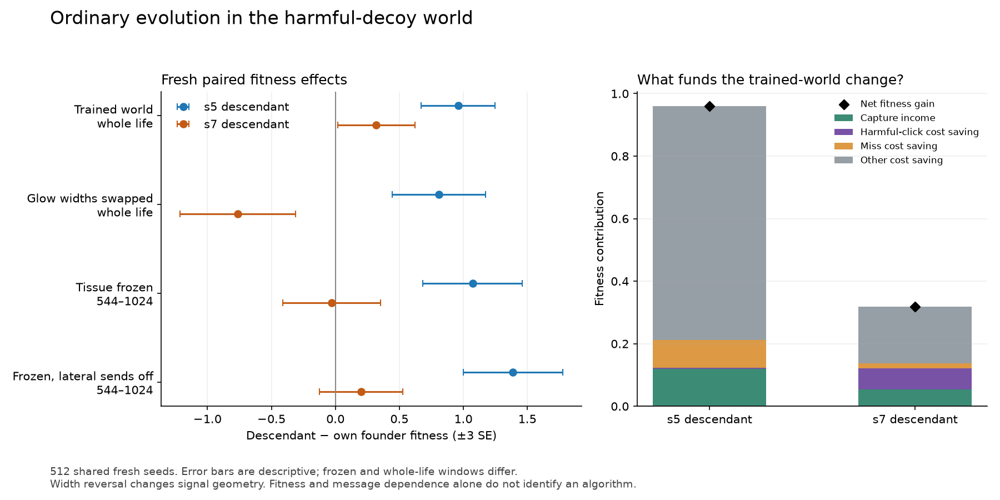

# U: further evolution in the harmful-decoy world

Completed: 16,460 research lives and six T200 startup validation lives, using **2,919.475449 of 7,200 local
CPU-seconds**. Both four-generation searches and all 8,192 fresh confirmation lives finished. All worker
processes and owned groups exited; the host clearance receipt is included. Source and cell rules were unchanged.

| Fresh paired comparison | s5 descendant | s7 descendant |
|---|---:|---:|
| Trained-world fitness gain over own I founder | +0.959061 ± 0.096004 | +0.319289 ± 0.100348 |
| Trained gain minus width-swapped gain | +0.149407 ± 0.156922 | +1.080313 ± 0.177314 |
| Added lateral dependence in frozen tissue | −0.314812 ± 0.169383 | −0.228469 ± 0.155575 |
| Trained captures per life, change | +0.246094 ± 0.181965 | +0.109375 ± 0.189304 |
| Trained harmful clicks per life, change | −0.046875 ± 0.255556 | −1.373047 ± 0.315032 |
| Terminal cells, change | −26.269531 ± 0.424521 | −7.925781 ± 0.273042 |

Values are means ± paired SE over 512 shared fresh seeds. Both trained fitness gains exceed three SE; only
s5 exceeds +0.5 F. These flags are descriptive, not a project-wide multiple-testing guarantee. Two fixed
founders with one search each do not estimate general evolutionary reliability.

**The main improvement is economy.** Capture income contributes +0.120163/+0.053406 F; all cost savings
contribute the remaining +0.838898/+0.265883. Neither capture increase is resolved. The s7 descendant reduces
harmful clicks and changes from +0.319289 F in the trained world to −0.761024 ± 0.150367 after the target and
decoy glow widths are exchanged. That is evidence of cue-pattern specialization, not a demonstrated classifier:
the reversal also changes the spatial geometry of useful signals. The s5 width interaction is unresolved.
Neither endpoint has resolved added lateral dependence in the matched frozen conditions. Freeze also stops
gene, phenotype and effective-weight updates, so these results do not identify a circuit or learning process.



Every confirmation row is free of guards, extinction, invalid and mismatch flags. Frozen pairs have constant
cell composition and exactly the expected cell-time over 544..1024. Full ledger reconstruction, all 60 raw
scored columns, aggregate bytes, paired covariance and cost decomposition reconcile independently. Legitimate
search guards were retained: the s7 run records three guarded initial evaluations in generation zero; search
invalid/mismatch fields are all zero. The retained summaries do not reconstruct every recheck guard count.

Recorded genetic replay reconstructs each run's 32 initial genomes, 896 offspring and final population/origins
bitwise. Final rank-zero IDs 501/543 bind to the completed checkpoints and both endpoints frozen before fresh
scoring. The replay checks recorded operations, not every original random draw. All data and code are preserved;
no endpoint substitution, partial inference, restart or budget extension occurred.

The original preparation README and manifest are in `preparation/`. PREREG.md and protocol.json retain the
prospective design. `reviews/` includes the 24 measurement, 40 monitor, 19 synthetic analysis and eight final
genetic corruption checks. No production source changed. `provenance.json` hashes every archive artifact.

Reanalyze without running lives:

```sh
.venv/bin/python results/decoy_evolution_20261014/analyze.py
```
