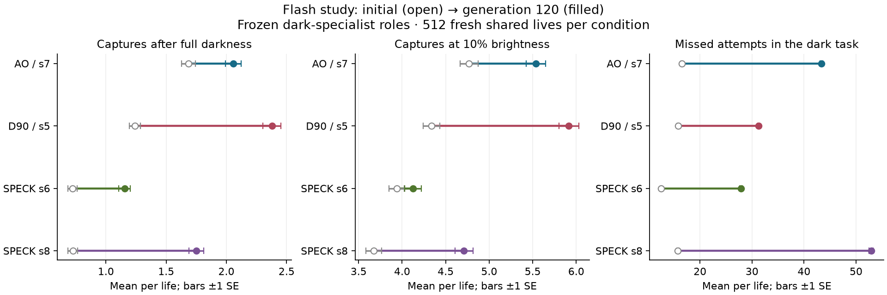

# Flash study: better dim-light acquisition, substantial tradeoffs

All four independent ancestral populations completed 120 generations and the predetermined fresh confirmation.
The primary performance criterion passed in **3/4** lineages: improvement in low-light captures at both
10% and zero residual brightness, each exceeding three paired standard errors. SPECK s6 did not pass
because its 10% contrast against its selected starting specialist was unresolved. This is performance
evidence within the trained flash family; it does not establish a memory mechanism or broad generalization.

## Frozen dark-specialist comparisons

Each row compares the development-selected initial-population genome with the development-selected final
genome. Each genome stays unchanged across brightness levels. Confirmation has 512 fresh shared lives per
condition; all choices at generations 0/60/120 were frozen before confirmation. ± denotes paired SE.

| Lineage | Dark captures, initial → final | Paired change | 10% captures, initial → final | Paired change |
|---|---:|---:|---:|---:|
| AO_s7 | 1.69 → 2.06 | +0.373 ±0.077 | 4.77 → 5.54 | +0.766 ±0.138 |
| D90_Z_s5 | 1.24 → 2.38 | +1.139 ±0.080 | 4.34 → 5.92 | +1.580 ±0.132 |
| speck_s6 | 0.72 → 1.15 | +0.432 ±0.059 | 3.94 → 4.13 | +0.189 ±0.126 |
| speck_s8 | 0.72 → 1.75 | +1.027 ±0.068 | 3.67 → 4.71 | +1.037 ±0.131 |

## Costs and failures matter

Dark-condition catches improved in every lineage, so the result is not solely cost cutting. Bodies also
became smaller and total physical costs fell. Every final dark specialist made more unsuccessful attempts
in every brightness condition. All four lost captures at 50% brightness relative to their starting dark
specialists. All final reporting genomes still have negative ordinary fitness in the zero-brightness task.

| Lineage | Dark-task misses, initial → final | Mean cells, initial → final | Final dark-task F |
|---|---:|---:|---:|
| AO_s7 | 16.51 → 43.38 | 87.9 → 68.9 | -0.850 |
| D90_Z_s5 | 15.79 → 31.24 | 127.5 → 69.3 | -0.702 |
| speck_s6 | 12.54 → 27.90 | 161.0 → 67.9 | -1.096 |
| speck_s8 | 15.75 → 52.92 | 93.6 → 59.5 | -0.894 |

The unchanged confirmation rule also reports balanced roles; their full results and generation-60
comparisons are in `summary.json`. They are not substituted for a failed primary specialist contrast.

## Retention and interpretation

The small fixed progress panels suggest lower POOL acquisition in all four sets of representatives and mixed
persistent/patch transfer. These use eight changing training-selected representatives and only 16 lives per
task; they are descriptive, not confirmed endpoint losses or whole-population estimates. Delayed matching
remains strongly biased toward the broad target, and hidden-cell counts generally decrease. No new memory
circuit, conditional-matching behavior or elaborate anatomy has been demonstrated.

Archive members supplied 100,431 of 215,040 parent draws (46.70%) and contributed to 70,905 of 107,520 offspring
(65.95%). The archive was used in breeding; this study does not isolate its benefit or lexicase's causal effect.
Late improvement differs across lineages; a blanket conclusion that every lineage needs more generations
is not supported. The next diagnostic removes target sensory signal from the eight frozen initial/final dark
specialists while preserving background rate, to measure how their net benefit from the flash changed.

## Execution and evidence

Completed in **6.26 elapsed hours / 48.48 CPU-hours**,
with **1.34 GiB** peak aggregate owned RSS. All four first attempts exited zero.
Inventory: 1,350,656 selection lives, 32,256 progress lives,
131,072 endpoint/confirmation lives and eight golden startup lives:
**1,513,992 total**. No scientific retries or configuration extensions.

Pinned source: `54c531026528b824bae7d670c3092ffe7abc9d39`. Reusable configuration:
`configs/flash_ladder.yaml`. `summary.json` includes paired measurements, hashes and the exact input sources;
`endpoints.json` contains the fixed reported genomes. Raw arrays/checkpoints and independent audits remain
under `outputs/flash_ladder_20261017/`. No raw arrays, binaries or duplicate source trees are published here.

Independent raw audit rederived all 24 reporting choices and 2,112 statistics from 36 raw blocks; all
131,072 development/confirmation lives have status zero. Maximum numerical discrepancy is 1.42e-14.
An audit-only field-alias reader error was preserved and corrected without new simulations.
