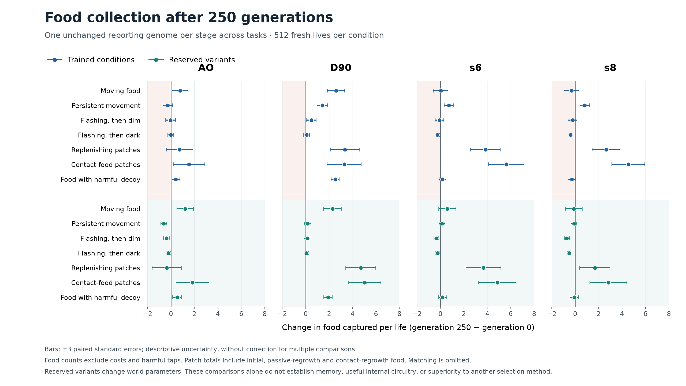

# Multitask evolution: broader acquisition, incomplete retention

All four populations completed 250 generations and fresh confirmation on **2026-10-19 at 12:27 Pacific**.
The study took **25.75 elapsed hours /188.77 CPU-hours**, with peak owned memory **1.26 GiB**. Every job
finished on its first attempt. No worker remains active in this completed queue.

**D90 is the clearest example of one genome improving across several acquisition demands. All four
populations also harvest more contact-produced food. Memory and lossless retention remain unestablished.**

## What improved

Each comparison below uses one unchanged genome per stage across all conditions. Values are food items
per life; uncertainty is one paired standard error over **512 fresh shared lives per condition**.

| D90 condition | Initial | Final | Change ± paired SE |
|---|---:|---:|---:|
| Moving food | 14.920 | 17.504 | +2.584 ±0.244 |
| Persistent pursuit | 5.070 | 6.486 | +1.416 ±0.148 |
| Replenishing patches | 17.178 | 20.521 | +3.344 ±0.412 |
| Contact-food patches | 19.828 | 23.119 | +3.291 ±0.483 |
| Moving food, reserved variant | 15.619 | 17.906 | +2.287 ±0.257 |
| Patches, reserved variant | 20.408 | 25.111 | +4.703 ±0.425 |
| Contact food, reserved variant | 22.572 | 27.619 | +5.047 ±0.458 |

D90's moving-food fitness gain is driven by more food despite increased cost: income contributes
+1.262 fitness and the cost change contributes −0.042, for net +1.220. Its food acquisition improves by
more than three paired SE in six of seven trained capture conditions and four of seven reserved variants.
The other conditions have unresolved changes under that descriptive threshold; that is not proof of no loss.

The figure excludes shape matching, where physical slot hits are not the same as correct choices.
Contact-food totals include initial stock, passive regrowth and contact-produced food. Error bars are
descriptive ±3 paired SE, without a multiple-comparison correction. Reserved conditions change parameters
within these task families; they are not entirely new objective types.

## Food produced by the organism's actions

In this world an empty-site tap can produce food after a delay. **All four final genomes harvest more
of that specifically contact-produced food**, in both trained and reserved conditions, by more than three
paired SE. They also improve total contact-world acquisition in both conditions.

| Population | Contact-produced harvest, initial → final | Total contact-world food, initial → final |
|---|---:|---:|
| AO | 3.344 →4.566 | 20.602 →22.146 |
| D90 | 3.477 →4.020 | 19.828 →23.119 |
| s6 | 2.160 →4.186 | 14.033 →19.652 |
| s8 | 3.412 →5.369 | 14.648 →19.186 |

s6's increase is **+2.025 ±0.138 contact-produced items**, nearly doubling its initial value. In its
reserved condition the increase is +1.396 ±0.101. This establishes better realized acquisition from a
delayed consequence of actions. Passive refill still supplies most food. Repeated tapping, movement and
revisiting could explain the gain without a memory of when food was planted; no timed-return mechanism
has been identified.

AO also improves harmful-target avoidance while catching more edible food: harmful taps fall from
**56.863 to 25.959**, while edible catches rise from **3.145 to 3.566**. D90 instead catches more edible food
in that world while harmful taps remain approximately unchanged (14.781 →14.881).

## What did not improve reliably

Shape matching still strongly favors the broad choice. Final correct choices per opportunity are:

| Population | Narrow cue | Broad cue |
|---|---:|---:|
| AO | 4.20% | 92.07% |
| D90 | 7.78% | 74.25% |
| s6 | 3.92% | 87.76% |
| s8 | 4.25% | 87.04% |

D90 responds correctly to more narrow cues than initially, but loses broad-cue success. These strongly
asymmetric outcomes do not demonstrate remembering the earlier shape. Longer-gap reserved matching is
similarly biased. The stored native `captures` field in matching counts physical slot hits; use the
separate class outcomes in [summary.json](summary.json).

Dark-flash capture improvement is unresolved for AO and D90. It regresses in s6 (1.375 →1.109) and
s8 (1.316 →0.922), both beyond three paired SE. All four remain negative in mean ordinary fitness in
the trained dark-flash condition. AO, s6 and s8 also lose acquisition on reserved dim/dark variants.
Several fitness gains coexist with food losses because costs fall. Fitness alone would overstate retention.

The second half of evolution still helped: D90 gains another +2.559 ±0.237 moving-food captures from
generation 125 to 250, and s6/s8 gain further contact-produced harvest. It also makes trade-offs:
s6's harmful taps increase from 17.557 at generation 125 to 30.281 at 250. More generations were useful
for acquisition, but progress was not uniform across abilities.

## Measurement and audit

Training used eight separately scored conditions, epsilon lexicase, 32 current genomes, 64 breeding archive
genomes and 224 offspring per generation. Every starting pool included all 96 original/flash-trained rows.
The final comparison selects one genome at each of generations 0/125/250 using 32 development lives per
trained task, a common exact-genotype reference and the previously frozen weakest-percentile rule. All
choices freeze before the 512-life evaluations on eight trained plus eight reserved conditions.

All four selected initial genomes are **flash-trained members of the full starting pool**, unlike the
original-row illustrations in the earlier viewer. This is the appropriate baseline for this study.
Selected IDs at generations 0/125/250 are AO 54/27974/55924, D90 40/27983/55818, s6 66/28061/55777 and
s8 74/27923/56070. [Frozen genomes](selected_genomes.json), [paired measurements](paired_measurements.csv).

An independent saved-data audit reconstructs all 12 choices, the deduplicated 288-genotype reference per
lineage, shared tie ranks, 27,456 summary statistics, 27,456 paired statistics and 1,152 matching ratios.
All **393,216 raw development/confirmation lives in 48 blocks** have status zero. Source, seed, world,
genome, checkpoint and native-library bindings pass. Total accounting is **7,651,336 lives**, including
selection, progress panels, development, confirmation and eight startup checks. Individual raw training
ledgers were not retained; their totals and selected-population validity counters are checked through logs.
[Audit and provenance](provenance.json). This analysis launches no new simulations.

## Direction after this result

Preserve the full populations and archives, with D90 a strong source of broader acquisition and s6/s8
sources of resource-task gains. A bounded intervention on contact-triggered production can determine how
much the evolved gains depend on that delayed feedback. It should distinguish useful interaction from
merely harvesting more passive supply.

The next broader environment direction remains navigation with obstacles and varied objectives. Selection
also needs a focused retention test: ordinary fitness allowed some capture losses to survive as cost savings,
and the current matching objective tolerated a large class bias. These are hypotheses to test, not proof
that lexicase or task diversity failed. This run has no matched selector/narrow-task control and establishes
neither sophisticated memory nor superiority to strong handwritten algorithms. No follow-on run is launched
by this report.
