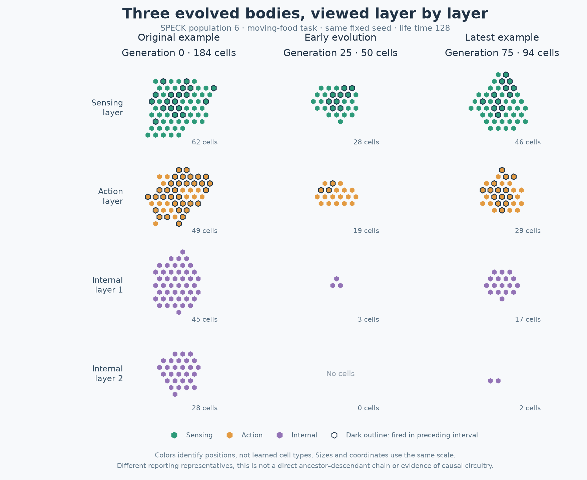
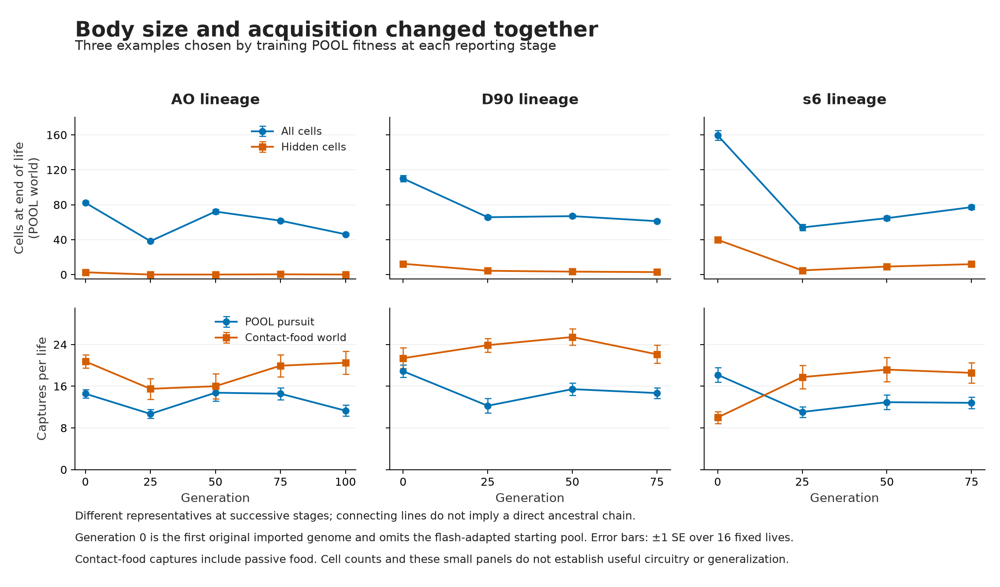
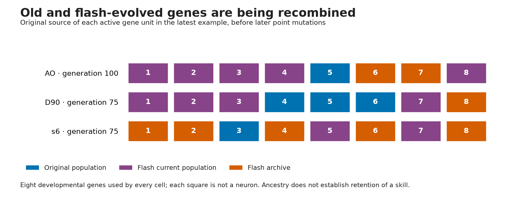

# Saved examples from the ongoing multitask evolution

[Open the interactive comparison](examples.html). Choose a population and environment, press **Play**,
or scrub through life. **From birth** shows development from the initial cell. The three cards show
the original example, generation 25 and generation 75 (100 for AO). The page contains recorded frames
and works offline; opening it performs no new simulations.

Colors identify positional sensing, action and internal layers. Recent firing appears white in the viewer
and with a dark outline in the still image.
The layer geometry is the simulator's fixed substrate; growth and occupancy evolve. These are views of
living tissue, not an identified circuit diagram. Matching choices and resource origins are observer labels,
not extra information supplied to cells.

## What changed

The strongest visible progression is **early shrinkage, followed in s6 by partial regrowth and a shift in
which food environments it handles well**. The following are means over 16 fixed reporting lives, not the
single replay seed. Cell counts are at the end of the ordinary pursuit task.

| s6 representative | Original | Generation 25 | Generation 50 | Generation 75 |
|---|---:|---:|---:|---:|
| All cells | 159.44 | 54.00 | 64.63 | 77.19 |
| Internal cells | 39.81 | 4.81 | 9.19 | 11.94 |
| Moving-food captures | 18.19 | 11.06 | 12.94 | 12.81 |
| Contact-food captures | 10.00 | 17.75 | 19.19 | 18.56 |

More internal tissue has returned after generation 25, but its computational contribution has not been
isolated. Resource collection is substantially higher than for this original example, while pursuit remains
lower. Contact-food totals include initial and passively replenished food; they do not establish farming.
In the single illustrated contact-food life, s6 generation 75 collects 18 items: six from initial stock,
eleven from passive regrowth, and one grown after a tap. This example is mostly passive-food acquisition.

**AO** illustrates a different outcome: its latest example averages 46 cells and almost no internal cells,
compared with 82 cells in the original. Contact-food collection is approximately retained (20.50 versus
20.75), but pursuit falls (11.31 versus 14.56). Compactness is not by itself a new capability.

**D90** is smaller too: about 61 cells versus 110 originally. Pursuit partially recovered after generation
25 (12.25 to 14.69 captures), remaining below the original's 18.88. Contact-food collection is 22.13 versus
21.38 originally. Intermediate generation-50 examples scored better than generation 75 on these tasks;
this is not steady improvement.

## What changed genetically

All examples still use **eight active developmental genes**. Each gene is part of the shared program used
locally by every cell; it is not one neuron. This study disables gene duplication/deletion, so it explores
recombination and parameter changes within those eight genes while allowing the body to grow different
numbers of cells. It cannot show what adding more genes would do.

The later examples contain gene units inherited from both their original and flash-trained populations:
AO has 1 original /7 flash-derived units, D90 3/5, and s6 1/7. They also carry mutations introduced during
this multitask study. This is verified genetic mixing; it does not yet prove useful behavioral primitives
were combined.

A concrete birth: **s6 genome 16839 at generation 75** inherited five active gene units from parent 16449
and three from parent 16405. Its two new mutations changed gene 0's sensitivity to its local sensory-plane
cue (1.35136 →1.65866) and gene 2's regulatory weight from gene 4 (2.80152 →2.57104). Their effects on the
organism's performance have not been isolated. Genetic coefficients are decoded through local gene state;
they cannot be read directly as a neuron's firing rate or a behavioral instruction.

## How these examples were chosen and checked

These are three independently maintained populations. At each later stage, we used the first saved
progress-panel position: the genome chosen by highest **training POOL fitness**, before its report-panel
evaluation. Generation zero is simply the first imported original genome. It excludes the other 95 starting
genomes, including the flash-trained group. Successive representatives are not assumed to be a direct
parent–child chain. The final one-genome-across-all-tasks generalization assessment remains pending.

The visual examples were fixed to AO generations 0/25/100, D90 0/25/75 and s6 0/25/75 before recording.
Each unchanged genome was replayed in moving-food pursuit, contact-food patches and delayed matching.
One fixed seed per environment—61018090/61018091/61018092 respectively—was shared across all nine genomes.
These seeds differ from the 16-life reporting panels; none were searched for a favorable outcome. Target
paths can diverge after different captures even with a shared starting seed.

All **27 full C lives and 27 JavaScript replays** completed on their first attempts. For every pair, all
143 ledger values match at the double-bit level and all five full event hashes match. All native statuses
are zero. Frames are saved every eight simulation-time units, so very brief events are summarized rather
than continuously animated. The recording pass used **95.65 CPU /83.97 wall seconds**, peak owned RSS
220 MiB, with over 17 GiB host memory available. The separate main evolution jobs remained running.

Genetic replay reconstructed **56,000 offspring** using logged crossover masks and float32 mutation deltas.
All **1,248 current/archive genomes across 13 saved snapshots** match exactly, including gene-origin IDs.
This analysis uses no organism simulations. [Saved summary](summary.json) includes the panel statistics,
birth details and snapshot hashes; [provenance](provenance.json) binds inputs, outputs and validation.
Raw records and reproduction scripts remain under `outputs/multitask_examples_20261018/`.

The viewer's syntax and supplied-data display/control checks pass, including all 27 actual recordings.
The static figures were visually inspected; a browser rendering check was unavailable in this environment.
Nothing here establishes a memory mechanism, a causal internal circuit, or generalization. The delayed
matching view is included to show an unresolved task, with correct/wrong choices counted separately.
