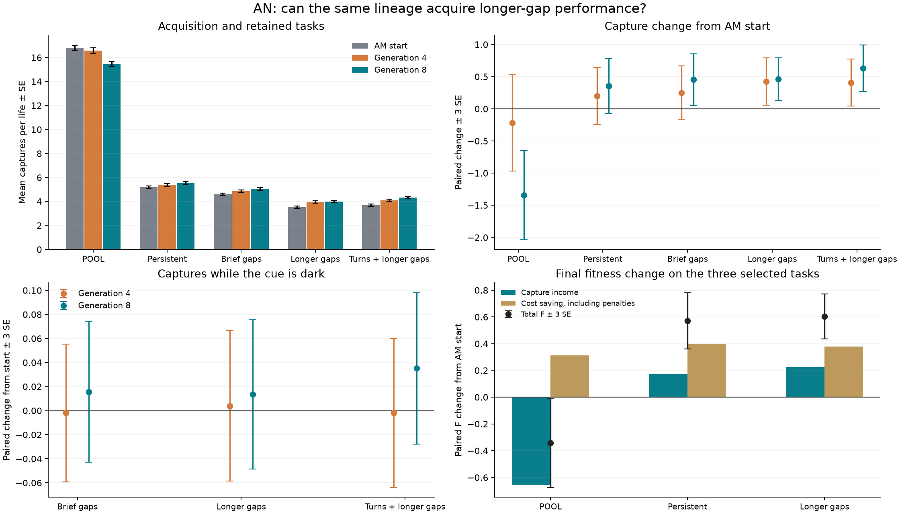

# AN: longer-gap acquisition, with a later tradeoff against an older skill

The continuing lineage gains **0.460938 ± 0.110891 captures per life** in the new longer-gap world, about 13% over its start. Almost all of that acquisition is already present at generation four. The next four generations chiefly save costs while losing captures on POOL, an older task. This supports useful adaptation and limited transfer, but not demonstrated memory or steadily accumulating capability.

All 32 ordered original-price AM survivors started one uninterrupted eight-generation ordinary search. Prices and local asynchronous cell rules stayed fixed. Every eight selection lives contained two POOL, two persistent and four irregular-blink lives with mean 80 on / 20 off, repeated for rechecking. Only the dark interval changed from the previously studied 80/5 setting. The native rank-zero genomes at generations four and eight were fixed before confirmation; the final endpoint was never replaced by the midpoint. Each fixed genome received the same 512 fresh lives in five worlds.

## Acquisition, transfer and retention

| World | AM start | Generation 4 | Generation 8 | Final minus start, paired mean ± SE |
|---|---:|---:|---:|---:|
| POOL | 16.792969 | 16.576172 | 15.451172 | **−1.341797 ± 0.230936** |
| Persistent | 5.183594 | 5.382812 | 5.537109 | +0.353516 ± 0.143199 |
| Brief darkness, 80/5 | 4.599609 | 4.851562 | 5.052734 | **+0.453125 ± 0.133757** |
| Longer darkness, 80/20 | 3.527344 | 3.953125 | 3.988281 | **+0.460938 ± 0.110891** |
| Faster turns plus longer darkness | 3.685547 | 4.091797 | 4.316406 | **+0.630859 ± 0.120726** |

Counts are mean captures per life. Bold paired effects clear the fixed three-SE diagnostic. The primary longer-gap gain has a lower three-SE bound of +0.128266. Persistent capture change remains unresolved, despite a positive point estimate. The faster-turn-plus-longer-gap combination was untrained in AN, and the exposure audit found no earlier exact setting. This is narrow transfer of the same fixed genome to one nearby combination, not broad generalization. All five cases become development evidence for future work.

Generation four gains **0.425781 ± 0.122610** longer-gap captures and passes both conventional 90% old-task retention diagnostics. Generation eight retains 92.0% of starting POOL captures in the point estimate, but its 90% retention margin is **+0.337500 ± 0.220262**, with a lower three-SE bound of **−0.323287**. Retention at that threshold is unresolved, not established failure below 90%; the absolute POOL loss is nevertheless resolved. Persistent retention passes at both checkpoints. A 90% convention permits some loss and is not a world-admission or selection rule.

The additional four generations give **+0.035156 ± 0.120157** longer-gap captures, an unresolved effect, while losing **1.125000 ± 0.234506** POOL captures. This does not prove a plateau. It does show that this observed later segment improved the aggregate objective without establishing further acquisition on the new task.

## Costs and observable behavior

| World | Final F change from start | Ordinary cost saving, F | Final capture-income change, F |
|---|---:|---:|---:|
| POOL | −0.343302 ± 0.110216 | +0.311873 | −0.655174 |
| Persistent | +0.570857 ± 0.070460 | +0.398242 | +0.172615 |
| Brief darkness | +0.605676 ± 0.066326 | +0.384424 | +0.221252 |
| Longer darkness | +0.604549 ± 0.055812 | +0.379482 | +0.225067 |
| Turns plus longer darkness | +0.684487 ± 0.060430 | +0.376450 | +0.308037 |

`ordinary_cost` in the archived arrays is a negative fitness contribution: its positive change means a saving. In longer darkness, generation-four-to-eight F rises **0.237060 ± 0.060541**, of which 0.219894 comes from ordinary savings and only 0.017166 from the unresolved capture change. Terminal bodies shrink: in persistent, about 96.92 → 91.74 → 81.16 cells; in longer darkness, 97.18 → 91.96 → 81.31. Hidden-cell means there rise temporarily from 1.00 to 3.91 and fall to 0.95. Counts alone establish no circuit mechanism.

There is useful behavior beyond simply clicking more. In longer darkness, mean captures increase while misses fall from 21.46 to 17.99 and total clicks fall from 24.98 to 21.98. The aggregate fraction of clicks capturing a target rises from 14.12% to 19.01% at generation four, then 18.15% at generation eight. In POOL it goes 43.65% → 50.19% → 47.36%, with the final capture loss still explicit. These fractions are descriptive totals, not independent-click estimates.

Dark-capture changes remain unresolved: final-minus-start is **+0.013672 ± 0.020774** in longer darkness, **+0.015625 ± 0.019538** in brief darkness, and **+0.035156 ± 0.020999** in the faster-turn combination. Almost all observed longer-gap capture gain is in bright periods. The longer-gap-versus-persistent capture interaction is also unresolved, **+0.107422 ± 0.153306**. Better performance in an intermittent-cue world does not establish memory or improved occlusion robustness.

Absolute bars show SE; paired changes show three SE. SVG and the exact plotted statistics are beside the PNG. An illustrative paused viewer is linked separately from the atlas; one fixed life is not a substitute for these full-sample results.

## What to try next

The user emphasizes both broad reconsideration and giving promising strategies enough time. More depth remains a live option; eight generations do not establish saturation. But more precise selection alone cannot guarantee retention: the observed later POOL loss and moving-world savings improve AN's weighted mean F by about 0.108. That tradeoff is permitted by the objective even without sampling noise.

Prepare a longer matched comparison from all 32 final survivors: keep the three existing contexts, all prices, and eight-plus-eight evaluation, with one branch retaining the 25/25/50 allocation and another using 50/25/25 POOL/persistent/longer-gap allocation. Give both 24 generations with fixed generation-eight and final checkpoints, and fresh paired confirmation against both AN start and the earlier AM reference. This tests more time with a modest retention emphasis, rather than another harder environment or price sweep. It cannot guarantee retention, estimate an optimal mixture, or establish search reliability from one matched pair. The new source-only study is not released by this report.

Circuit probes, more evaluation precision, price adjustments and operator changes were considered. They remain alternatives after the next complete result. No evidence currently requires additional hardware or paid resources.

## Verification and resources

All **28,214 research + 8 startup = 28,222 calls** completed in **3,679.509834 CPU / 1,484.136535 wall seconds**. Search used 2,581.161125 CPU seconds and confirmation 1,098.348709, within the fixed caps. Peak sampled owned RSS was 312.824219 MiB. All three process identities and both groups are clear in their original host namespace. No retry, research scope extension or rented compute occurred.

All 7,680 confirmation statuses are zero. Initial-search guarded counts were [0, 0, 0, 8, 0, 6, 0, 0], with native penalties retained; invalid and mismatch counts are zero. Full per-life search ledgers were not saved. Independent genetic reconstruction matches all 1,792 offspring, 3,584 point additions, final 32 genomes/origins, and the independent 32-row midpoint with exact log prefixes. Logged pooled selection checks pass; omitted unsuccessful-parent base scores and exact tie permutations limit full initial-ranking reconstruction. This offline audit used another 4.886713 CPU seconds and no simulations.

The frozen reader passes unchanged. The independent literal accountant reproduces all **2,933 paired vectors** with zero error, and a separate unchanged-reader run reproduces summary and NPZ bytes. All 15 aggregate capture/click ratios reconcile independently.

Two bookkeeping mistakes are preserved: a pre-release root wrapper expected the wrong review-status label and invoked the monitor without a release; it refused before creating any attempt, worker, build or life. Separately, the terminal accuracy helper initially used three wrong descriptive key names; a separately retained correction changes only those keys. Neither changed scientific sources, data or comparisons. The successful research run was its first owned attempt.

Prospective commit: `0a95793`.

- Protocol: `ca277b17294bbce52a4fd6bde77e5847b6b5230c00d285ba8492538f7508b26b`
- Summary: `1ce6412d0f063a429911ca80a5bc95c48cde08c087030a11def1abe46ac64512`
- Budget: `29f26b5c8331c155bb9974ccdc286c3049660e9181b6fea1323ab08d2bac5365`
- Native audit: `865b1a898e1003c13b153f0c6a6a986b80a2b37bd8b12bedbe91f454a65b66bb`

Reanalysis: `.venv/bin/python results/occlusion_acquisition_20261015/analyze.py --out outputs/an_reanalysis` (choose a new output directory). This runs no simulations.
