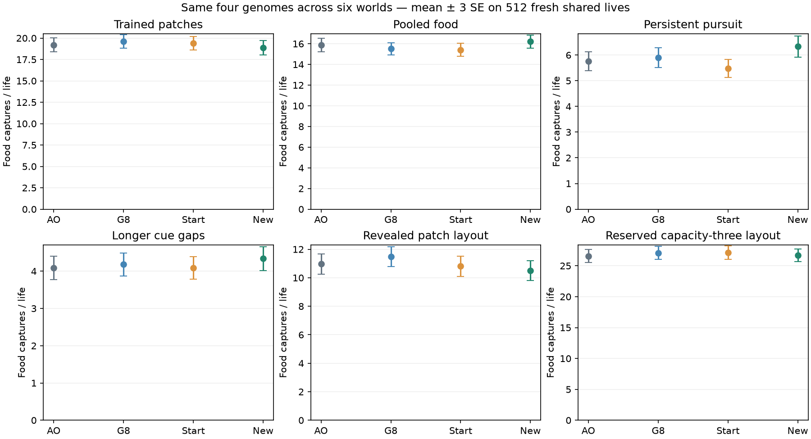
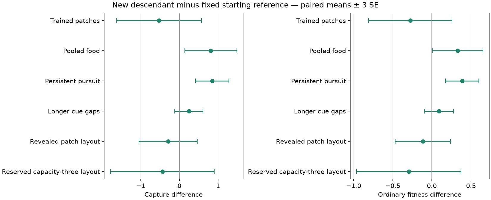

# Older-task acquisition improves; patch improvement remains unestablished

The deeper continuation improves POOL and persistent-pursuit acquisition relative to its fixed Pareto4
comparator. Those gains survive higher physical costs and appear in ordinary fitness. The trained patches,
longer cue gaps and two patch-layout tests do not show changes exceeding three paired standard errors in
the primary comparison. This is useful recovery of older abilities, without a demonstrated joint acquisition
improvement or a new resource-patch strategy.

The same descendant clears all nine registered 90% retention diagnostics: three older worlds against each
of AO, the fixed G8 comparator and the fixed Pareto4 comparator. That threshold permits up to 10% loss; it
neither establishes lossless retention nor proves gains against every founding genome.

## What was fixed and measured

All 32 ordered survivors of the prior Pareto population received eight additional generations. Initial and
recheck samples increased to 32 lives each, with unchanged acquisition objectives, 50/25/25 training-world
allocation, physical prices and genetic operators. This single pilot changes both depth and evaluation
precision; it cannot attribute the outcome to either change separately.

A separate training-only panel measured all 32 final genomes on 32 lives in each of three worlds. The
registered minimum scaled acquisition, weighted ordinary-F and native-ID rule selected **row 24, native
ID 1415**. This genome was frozen before confirmation. It then faced 512 fresh shared lives in each of six
worlds alongside unchanged AO (ID 5336), G8 joint (ID 1795) and Pareto4 joint (ID 918). The latter two are
prospectively fixed comparators chosen from the preceding development panel; earlier published reporting
genomes are not replaced. The new endpoint is not a retrospective replacement of any historical result.

## Fresh confirmation

New descendant minus fixed Pareto4 comparator, mean ± paired SE over 512 lives:

| World | Food captures | Ordinary F | Physical energy cost |
|---|---:|---:|---:|
| Trained patches | -0.529297 ± 0.365804 | -0.274523 ± 0.177942 | +16.463593 ± 15.573270 |
| POOL | +0.812500 ± 0.223576 | +0.330844 ± 0.106961 | +67.466120 ± 8.884444 |
| Persistent pursuit | +0.849609 ± 0.144374 | +0.386901 ± 0.071118 | +28.618153 ± 9.875667 |
| Longer cue gaps | +0.246094 ± 0.122139 | +0.092420 ± 0.061322 | +28.408813 ± 9.032509 |
| Revealed two-patch layout | -0.294922 ± 0.251391 | -0.114248 ± 0.117744 | -30.470886 ± 11.539526 |
| Reserved capacity-three layout | -0.439453 ± 0.447964 | -0.293678 ± 0.222497 | +80.999404 ± 14.455323 |

POOL and persistent capture and F gains exceed three SE. All four other primary capture and F intervals
include zero at three SE. These are uncertainties over fresh lives, not replicated evolutionary searches;
the displayed three-SE comparisons are descriptive and do not correct for inspecting multiple readouts.

POOL's extra food contributes **+0.396729 F** and extra physical cost subtracts **0.065885 F**, leaving
+0.330844 F. Persistent pursuit contributes +0.414848 F from food and −0.027947 F from added cost,
leaving +0.386901 F. Thus these gains are not produced by cheaper bodies. Maintenance costs rise in all
six worlds, partly offset by fewer paid misses; no circuit or memory mechanism is identified by this ledger.
All eight physical cost components and their uncertainties remain in `summary.json`.

Against AO, persistent capture improves **+0.576172 ± 0.144897** and F improves **+0.285001 ± 0.070534**;
other capture differences are unresolved at three SE. Against G8 joint, POOL capture improves
+0.699219 ± 0.218489, but the revealed two-patch layout loses **−0.982422 ± 0.233320 captures** and
−0.513865 ± 0.109948 F. That resolved loss limits a claim of cumulative generality even though the primary
comparison and older-world retention diagnostics improve.

The descendant's AO-relative capture point ratios are 102.12% in POOL, 110.01% in persistent pursuit and
106.12% with longer cue gaps. All corresponding 90% margins clear three SE; the full nine comparisons are
in [TABLES.md](TABLES.md). They do not convert unresolved absolute differences into lossless-retention claims.

## Initial food and continuing acquisition

The descendant harvests **18.875000 ± 0.280587** packets in the trained patches: **5.691406 ± 0.039935**
from initial stock and **13.183594 ± 0.258055** from replenishment. Its refill difference from Pareto4 is
−0.486328 ± 0.334967 packets, so this study does not establish better continuing patch acquisition.

In the new reserved layout, it harvests **26.708984 ± 0.334943** packets: **10.916016 ± 0.081396** initial
and **15.792969 ± 0.291281** replenished. This layout has four capacity-three patches rather than three
capacity-two patches and therefore starts with more food. Its larger absolute total is not evidence of
improved generalization. The paired reserved-layout difference from Pareto4 is unresolved; refill alone
changes −0.425781 ± 0.384835. The formerly reserved two-patch arrangement is exposed development evidence.

## Execution and independent checks

All **97,334 research + 8 startup = 97,342 calls** completed on the first scientific attempt in
**7291.161815 CPU / 3611.875809 wall seconds**, with **343.80 MiB** peak owned RSS. Search used
6187.020633 CPU seconds and endpoint/confirmation measurement used 1104.141182. Both owned phases
exited successfully and cleanup records show no remaining worker groups, identities or descendants.
Charging the full 180-second preparation/terminal reserve gives **7471.161815 CPU / 3791.875809 wall**,
below the registered 10,800 CPU / 7200 wall caps. One two-thread worker, 4 GiB RSS, 8 GiB address space
and a 4 GiB host reserve were enforced. No paid compute was used.

The independent recorded-genetics/selection audit checks 1,792 offspring, 3,584 point additions, all
32 final rows, 16 rankings, 24 supplied tie permutations and the 81,920 saved selection lives. Independent
scalar accounting checks all **3,072 endpoint + 12,288 confirmation ledgers**, the weighted endpoint rule,
summary moments, paired contrasts, retention margins and all eight startup calls. All confirmation statuses
are zero; no guard or extinction row was dropped. Both audits passed on their first execution, using
2.07 and 1.44 external CPU seconds. Saved-data tables and plots used 1.69 CPU seconds; plots were visually
inspected. These terminal checks ran no simulator, build or new random draw.

The archive preserves the original prospective registration, frozen sources/inputs, selection arrays,
checkpoint and genetic logs, raw/scored cohorts, original compiled identity binaries and independent
receipts. Fast research hashes are constants, so they do not establish full trajectory replay. The evidence
does not identify a memory mechanism, a capacity ceiling, or performance beyond strong handwritten baselines.
The follow-up judgment is in [NEXT_DECISION.md](NEXT_DECISION.md); no new scientific study was launched.
