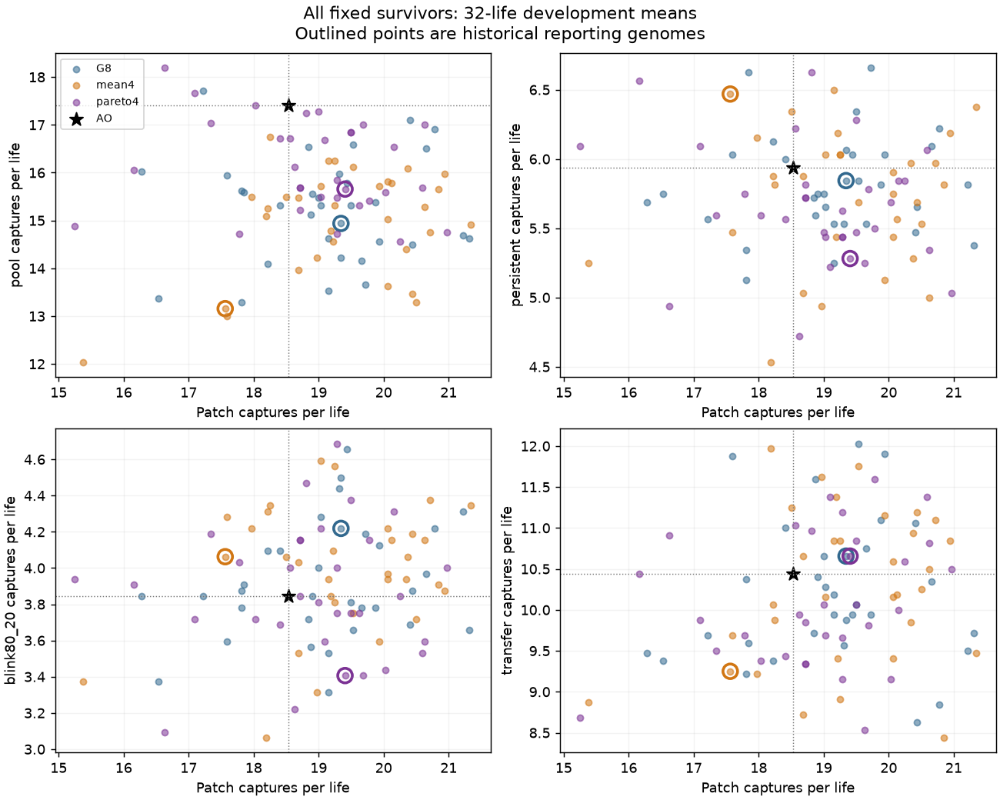
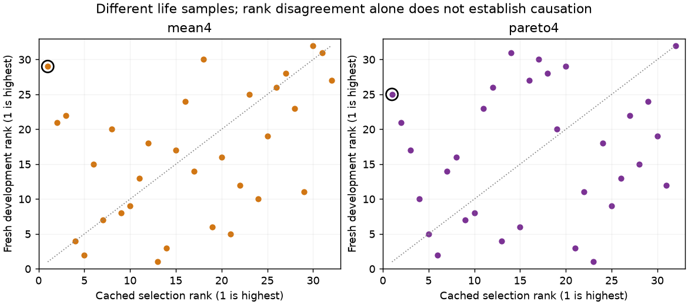

# Useful survivor variation remains; cached reporting ranks are unstable

The complete fixed panel shows that the previously reported genomes are weak representatives of their
populations by the joint-acquisition rule. The ordinary branch's cached first choice ranks **29th of 32** on
the fresh panel; the acquisition-aware branch's first choice ranks **25th**. The G8 reporting genome ranks
15th. These are descriptive ranks from a new 32-life sample, not evidence that any newly selected row is a
confirmed winner or that scoring noise alone caused the earlier strategy difference.

The strongest population-level change is increased POOL acquisition in the Pareto branch. Its large
historical-endpoint pursuit losses are not established across all survivors. The population still contains
different combinations of useful abilities; no combined improvement or new algorithm is demonstrated.

## Fixed experiment

All 32 ordered genomes from G8, ordinary mean4 and Pareto4, plus unchanged AO, faced the exact five worlds
from the preceding selection comparison. Every row, including possible duplicates, was retained. All three
populations turn out to have 32 distinct raw genomes. All 97 genomes shared 32 new life seeds in each world.
The formerly reserved count-two patch arrangement is now development evidence.

No mutation, additional evolution or endpoint replacement occurred. Per-population uncertainty uses the
32 shared-seed population means, not the 32 genomes as independent life replicates. All results below are
means ± paired SE over these life seeds; three-SE bounds are exploratory and do not adjust for examining
many genomes. See [all tables](TABLES.md), [all rows](population_rows.csv) and the complete `summary.json`.

## Population comparisons

Pareto4 minus mean4, averaging all 32 survivors within each life seed:

| World | Capture difference | Ordinary F difference |
|---|---:|---:|
| Trained patches | −0.470703 ± 0.335128 | −0.493659 ± 0.173371 |
| POOL | +1.166016 ± 0.239681 | +0.382953 ± 0.113364 |
| Persistent pursuit | −0.070312 ± 0.113821 | −0.233495 ± 0.058525 |
| Longer cue gaps | −0.121094 ± 0.083742 | −0.248967 ± 0.042982 |
| Revealed patch combination | −0.159180 ± 0.221240 | −0.275471 ± 0.105367 |

Only the POOL capture gain exceeds three SE. Pareto's physical costs are higher throughout: approximately
270 energy units on trained patches, 191 in POOL, 204 in persistent pursuit, 194 with longer gaps and 202 in
the revealed patch combination. Thus near-equal acquisition can coexist with worse ordinary F. Larger or
more expensive bodies are not evidence of more sophisticated computation.

Against the full G8 population, Pareto adds **0.875977 ± 0.191965 POOL captures**. The patch, persistent,
longer-gap and revealed-combination capture differences remain unresolved. The ordinary branch likewise
has no capture change exceeding three SE against G8 in this panel. These are observed population shifts
within one matched evolutionary pair, not independent replications of the search strategies.

The earlier 512-life endpoint comparison remains valid for its fixed genomes. This diagnostic asks a different
question and does not revise those endpoints: its population-level pattern differs from the selected-genome
pattern. In particular, a strong gain of one reporting genome on the reserved arrangement did not establish
that its entire population acquired that advantage.

## Retained combinations and selection precision

The fresh joint-minimum medians are 0.9237 for G8, 0.9251 for mean4 and 0.9211 for Pareto4, using the three
fixed historical AO capture scales. Their observed maxima are 1.0505, 1.0107 and 1.0238. These maxima are
selected noisy estimates and cannot establish a joint improvement.

On point estimates alone, **10/32 G8, 8/32 mean4 and 16/32 Pareto4** survivors retain at least 90% of AO's
captures in all three old-world diagnostics: POOL, persistent pursuit and longer gaps. None clears all three
descriptive lower-three-SE margins. That uncertainty neither certifies retention nor proves useful combinations
absent. The 90% diagnostic also permits some loss.

The cached endpoint rule had only eight patch, four POOL and four persistent lives per survivor. Both first
choices rank poorly on the fresh 32-per-world sample. This supports testing better measurement of candidates;
it does not establish how much extra evaluation improves evolution, or identify crossover as the bottleneck.
No historical endpoint is replaced by a favorable row from this panel.

## Execution and checks

All **15,520 research + 4 startup = 15,524 calls** completed on the first scientific attempt in
**861.068225 CPU / 429.966323 wall seconds**, with peak owned RSS **344.30 MiB**. All 15,520 research statuses
are zero; no guard or extinction row is removed. Owned processes are cleared. Charging the full 60-second
preparation/terminal reserve gives **921.068225 CPU / 489.966323 wall seconds**, below the registered
2,700 CPU / 1,800 wall limits. No paid compute was used.

Seven supplied-array reader checks passed before publication. The completed independent scalar audit checks
every research ledger, all 20 raw/scored cohort pairs, 25,288 statistics, 97 fresh ranks, 64 cached ranks and the
four retained startup calls. The first saved-data audit exhausted its 10-CPU-second allowance because it
repeatedly decompressed NPZ arrays inside the life loop. Caching each returned cohort once fixes that I/O
inefficiency; the corrected audit passes in 1.23 CPU seconds with unchanged arithmetic. The original checker,
failure and logs are preserved. No scientific life was repeated for this correction.

The plotted figures were visually inspected. They show development means, not trajectory or circuit evidence.
Fast hash fields are constants and do not establish trajectory replay. This study demonstrates neither memory,
prediction, a capacity ceiling nor broad unseen-task generalization.

The next-step judgment is recorded in `POSTRUN_RECOMMENDATION.md`. This completed diagnostic releases no
additional run automatically.
