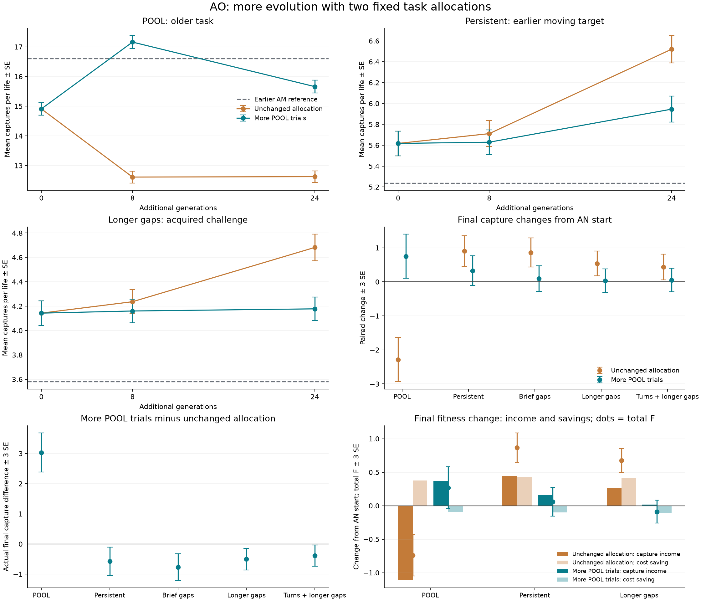

# AO: more time adds acquisition, while task allocation trades retention against further gains

Both fixed 24-generation branches completed. The unchanged 25/25/50 POOL/persistent/longer-gap allocation
adds captures after generation 8, so stopping at the early checkpoint would have missed useful improvement.
Increasing POOL's share to 50/25/25 preserves the older task substantially better, but yields fewer captures
in the other contexts. The preregistered joint primary criterion does not pass.

All differences below are paired means ± SE on 512 shared fresh lives. These are descriptive bounds, not a
simultaneous claim across all 11,967 reported vectors. All five worlds were already development-known.

| World | AM reference | AN start | Unchanged 8 | Unchanged 24 | More POOL 8 | More POOL 24 |
|---|---:|---:|---:|---:|---:|---:|
| POOL (older task) | 16.609 | 14.910 | 12.613 | 12.627 | 17.160 | 15.660 |
| Persistent target | 5.238 | 5.617 | 5.711 | 6.520 | 5.629 | 5.945 |
| Brief gaps | 4.773 | 4.951 | 5.119 | 5.812 | 5.104 | 5.047 |
| Longer gaps | 3.580 | 4.143 | 4.236 | 4.682 | 4.160 | 4.178 |
| More turns + longer gaps | 3.770 | 4.156 | 4.371 | 4.594 | 4.166 | 4.207 |

The final allocation contrast is **+3.033203 ±0.215803 POOL captures**, but **−0.503906 ±0.119337 longer-gap
captures** for more-POOL minus unchanged. Both absolute effects exceed three SE. The more-POOL endpoint retains
89.24% of the unchanged endpoint's longer-gap captures in the point estimate; the explicit 90% margin is
**−0.035742 ±0.112710**, spanning zero at three SE. Thus joint superiority plus 90% noninferiority is not
established. This is not a resolved finding that retention is below 90%.

## More time was useful in the unchanged branch

Relative to AN start, unchanged generation 24 gains **+0.902344 ±0.150742 persistent captures**,
**+0.861328 ±0.141995 brief-gap captures**, **+0.539062 ±0.121137 longer-gap captures**, and
**+0.437500 ±0.126005 turns-plus-gap captures**. It loses **2.283203 ±0.217140 POOL captures**.
The final older-task retention is about 84.7% of AN start and 76.0% of the earlier AM reference; both 90%
retention margins are below zero even at their upper three-SE bounds.

Generation 8 to 24 adds **+0.808594 ±0.138866 persistent**, **+0.693359 ±0.136585 brief-gap** and
**+0.445312 ±0.114106 longer-gap captures**. These exceed three SE. The longer-gap fitness increase is
0.254071 ±0.055074, of which only 0.036633 is ordinary cost saving: this later step is chiefly acquisition,
not just economy. POOL change over the same interval is unresolved (+0.013672 ±0.197245).

This is evidence of improvement along this observed trajectory, not a randomized comparison proving a general
24-generation policy better than an 8-generation policy. There is one matched evolutionary pair.

## More old-task exposure preserved capability, with a late economy tradeoff

More-POOL generation 24 gains **+0.750000 ±0.216118 POOL captures** over AN start; its changes in the other
four worlds are unresolved at three SE. It passes all five specified own-start/older-reference 90% diagnostics,
including 94.29% point retention of AM's POOL captures. It nevertheless loses **0.949219 ±0.219510 POOL
captures** relative to AM: passing the diagnostic permits some real loss.

Generation 8 already has +2.250000 ±0.237100 POOL captures over AN start and passes the same five retention
checks. From 8 to 24, POOL falls **1.500000 ±0.246892**, while longer-gap captures change only
+0.017578 ±0.113541. Longer-gap fitness rises 0.302484 ±0.056551, almost entirely ordinary savings of 0.293901.
Mean longer-gap terminal body size falls from 100.91 to 88.01 cells over that interval. In the unchanged branch,
it changes only 68.21 to 66.89. Body/hidden-cell counts do not establish a circuit mechanism.

The allocation manipulation changes both objective weighting and the number of samples per context. It does
not isolate weighting from scoring precision or establish optimal mixture proportions. The fixed generation-24
endpoints remain the primary comparison; the generation-8 observations do not replace them.

## What has not emerged in this measurement

Neither branch adds resolved dark-period captures over AN start. Longer-gap differences are
−0.005859 ±0.021145 (unchanged) and −0.013672 ±0.021674 (more POOL). Most added captures occur with useful
current cues. There is no demonstrated new memory algorithm, prediction, broad held-out generalization or
new circuit mechanism here. The results do not establish a capacity ceiling or a need for rented compute.

The user asked us to prioritize richer interactions before outcomes were inspected. We now proceed with the
[delayed-matching environment](../../docs/ABI5_DELAYED_MATCH_PROPOSAL.md): sample, blank interval, then a choice
whose value depends on the sample. The user clarified that environment/ABI work of this kind is covered by
autonomy. Its implementation is isolated while this archive is completed. Earlier tasks remain capability
checks; perfect retention or cost tuning is not a prerequisite. The continuing population for its first
selection study will be chosen explicitly from development evidence, with fresh evaluation and no claim that
shared ancestry alone establishes generalization.

## Execution and verification

- Both arms import all 32 ordered AN survivors, preserving duplicates, then use matched fresh native RNG53232.
  These are fresh continuations, not exact AN resumes. Each uses 24 generations, native32+224, two point
  mutations, 8 initial +8 recheck trials, original prices and fixed generation8/24 rank0 endpoints.
- All **138,476 research +12 startup =138,488 calls** complete in **24,128.826457 CPU seconds** and
  **9,719.899554 wall seconds**. Search uses21,240.558543CPU; confirmation2,888.267914CPU. Peak owned memory
  is314.410156MiB. Fixed caps were28,800CPU /14,400wall, including separate24,000search/4,800confirmation ceilings.
- All15,360 confirmation lives have status0. Native guarded evaluations keep their penalties; no invalid
  population, recheck-invalid or accounting mismatch appears. Four process identities and three worker groups
  are independently cleared in the original host namespace. No retry, scope reduction or cap extension.
- Full native replay verifies10,752 offspring and21,504 mutations across both branches, all32 rows at each final
  endpoint, and independent32-row midpoint reconstruction. Missing unsuccessful-parent base scores and exact tie
  permutations limit proof of initial ranking; the audit states those limits.
- Independent literal accounting reproduces all30 raw rows, all11,967 paired vectors and30 accuracy rows exactly.
  A separate corrected-reader replay reproduces the summary and compressed arrays byte-for-byte. Native audit
  adds8.882293CPU and raw recount5.016802CPU, with no simulations, builds or scientific random draws.
- The original frozen reader stopped before emitting outcomes because the earlier assistant-server restart
  changed the surviving monitor's parent PID. The monitor's PID/group/start time and every worker's ownership
  stayed exact. A separately reviewed reader allows only the recorded parent change, while retaining all
  scientific functions and other checks. Original reader, original failed output, metadata diagnosis, two host
  clearances, explicit patch and source-equivalence evidence are preserved. No scientific input was rewritten.
- The viewer uses12 existing first-seed JS replays, with690 ledger values matching C bit-for-bit. It starts
  paused; all30 absolute aggregate rows remain visible. These examples use seed52,420,000 without selection
  by outcome. Existing366 mock UI assertions were checked during preparation; no real-browser test is claimed.
  Replay uses11.999376CPU/10.036325wall seconds and117.871094MiB peak. An approval-service timeout started no
  process; the bounded replay then completed in its own sandbox process namespace with all owned processes gone.

[Watch the fixed illustrations](../atlas/retained_depth.html). Full source and data are in this archive;
`analysis_result/summary.json`, `analysis_result/paired_arrays.npz`, `terminal_review/independent/`,
`terminal_review/native/`, and `terminal_review/reader_repair/` contain the main evidence.
Reproduce with the separate `terminal_review/reader_repair/analyze_terminal_reparent.py`, supplying this archive
as `--study` and a new directory under `outputs/` as `--out`. The original `analyze.py` remains frozen and rejects
the historical parent-PID change.

Protocol SHA: `2cfc3ac9a6d41e2d3c49e630a7bc611ff9737962175def3d1eb89e6d8de6d68d`.
Summary SHA: `73282b171e043a88667747da8ed04fdf78dff47d7266039f765fd2cd9c3cf895`.
Native audit SHA: `b4697b9549f4c9a9ff1b78277ba0a99941dd8d538c6ac63aa3b111aa6b3a4a8e`.
Independent raw audit SHA: `d148ad5e9832a2de6148bfcbb4c8134cbb7753c6e23a9f7e3ab5e6a7417c4d6e`.
