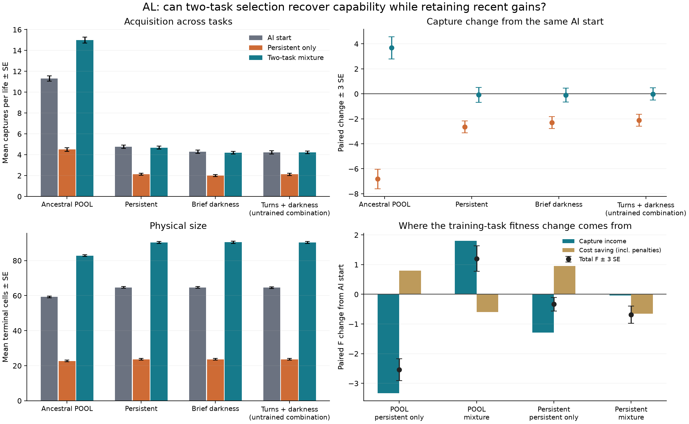

# AL: two-task selection recovers ancestral captures; persistent retention remains uncertain

The two-task branch makes a real acquisition gain in ancestral POOL: **+3.683594 ± 0.298366 captures per life**
over its AI starting genome. Persistent-target captures are almost unchanged in the mean, **−0.078125 ± 0.199511**,
but the fixed 90% retention criterion remains unresolved. This is promising partial recovery with extra physical
cost, not established lossless accumulation, a new algorithm, or broad generalization.

Both four-generation searches began with all 32 ordered AI-control survivors and identical first-generation
candidate genomes. One selected on persistent targets only; the other split selection lives equally between
POOL and persistent. Native raw mean fitness, prices and local asynchronous organisms were unchanged.
Final rank-zero genomes were fixed before 256 shared fresh lives in each of four worlds.

| World | AI start captures | Persistent-only endpoint | Two-task endpoint |
|---|---:|---:|---:|
| Ancestral POOL | 11.324219 | 4.503906 | 15.007812 |
| Persistent target | 4.765625 | 2.128906 | 4.687500 |
| Brief irregular darkness | 4.296875 | 2.000000 | 4.195312 |
| Turns + darkness, excluded from selection | 4.230469 | 2.117188 | 4.218750 |

The primary mixture-minus-control POOL effect is **+10.503906 ± 0.296786 captures**. Much of that large relative
effect reflects control deterioration, so the separate own-start gain above is essential. No fresh original L92
baseline was included; this experiment does not establish restoration to the original ancestor's performance.
Numbers below are paired means ± SE; decisions use the predeclared unrounded three-SE rule.

| Mixture minus AI start | Captures | Fitness F | Ordinary cost saving, in F |
|---|---:|---:|---:|
| POOL | +3.683594 ± 0.298366 | +1.203470 ± 0.142712 | −0.595160 ± 0.011791 |
| Persistent | −0.078125 ± 0.199511 | −0.687747 ± 0.096043 | −0.649600 ± 0.014551 |
| Brief darkness | −0.101562 ± 0.183552 | −0.680127 ± 0.088034 | −0.630536 ± 0.013630 |
| Turns + darkness | −0.011719 ± 0.162366 | −0.640360 ± 0.078412 | −0.634638 ± 0.014459 |

The mixture retains 98.36% of the start's persistent mean captures, but the paired 90% margin is
**+0.398437 ± 0.189813**, with lower three-SE bound **−0.171000**. Thus the experiment has neither established
the permitted retention margin nor a persistent capture loss. There is no resolved own-start gain in the two
darkness cases, including the one untrained combination. These revealed cases now become development data.

Physical cost rises. Mean terminal cells increase from **59.293 to 82.875** in POOL and **64.641 to 90.363** in
persistent. POOL capture income rises **1.798630 F**, exceeding the additional ordinary cost **0.595160 F**.
In persistent, similar captures plus additional costs reduce fitness. Mean terminal hidden cells also rise
(POOL 0.879 to 1.547; persistent 1.137 to 2.379), but counts do not establish functional circuitry or computation.
Whole-genome and whole-development comparisons do not isolate body size or any circuit as the cause.

The persistent-only endpoint loses **2.636719 ± 0.160385 captures** and **0.331624 ± 0.076098 F** even in its own
training world, despite saving **0.955837 F** in ordinary costs. Its failure therefore cannot be described solely
as successful optimization of cheaper behavior. Sparse four-plus-four-life selection and evolutionary noise
remain plausible contributors. One paired four-generation realization cannot establish policy reliability.

The user's subsequent direction explicitly asks whether cost penalties encourage the desired capabilities.
The next priority is a bounded local comparison of incentives, informed by physical cost contributions and
separately labeled repricing of saved outcomes. Repricing establishes ranking sensitivity, not what would evolve.
Capture performance, retained abilities, physical costs and selection noise must all remain visible.

All **13,388 research plus eight startup lives** completed in **1,098.051813 CPU-seconds / 450.990839 wall seconds**,
well within the 5,400 / 3,600 limits. Peak sampled owned RSS was **324,759,552 bytes** (about 310 MiB), below the
4 GiB stop, with an 8 GiB per-worker address-space limit and a 4 GiB host-memory reserve. Four process identities
and three groups are cleared in the original PID namespace. There was no retry, extension or paid compute.

All 3,072 confirmation statuses are zero. Native search records retain four initial guarded lives in control and
two in mixture, with their penalties; full native per-life ledgers were not retained. Each arm's 896 offspring,
1,792 recorded point mutations, all four generations and all 32 final genomes/origins reconstruct bit-for-bit.
Recorded pooled shortlist selection passes; omitted parent initial scores and tie permutations limit independent
verification of the first-stage ranking. Rank-zero endpoint IDs are control **720**, mixture **925**.

The unchanged reader and a separate literal-index accountant agree exactly on all **2,254 paired vectors**.
Independent reader output reproduces summary and vector archive bytes. Offline genetic verification used
4.258 CPU-seconds separately from research accounting and made no random draws or simulations.

Prospective publication: `da2a01f`, completed evidence archive `6ad0266`.
Protocol: `25575f9ef690d00741fea0c62570d15aeb526d66a13a42025a91c5cd2fad19bf`.
Summary: `29e464929a7ab43e404688e939de81a4bfdb7bbafd48b9220225f443669d5555`.
Budget: `e7602ddcba63abfd721d15eedc0c3599229f82ef7783c8b19fdb68cea5b69d00`.
